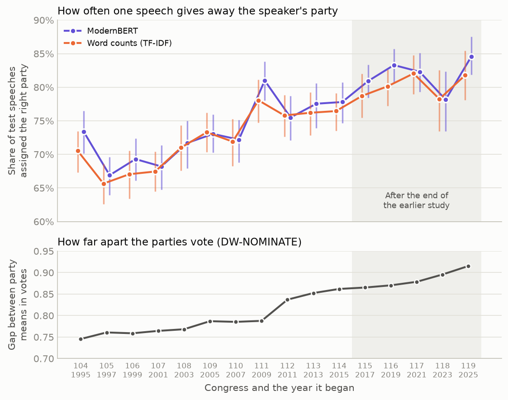
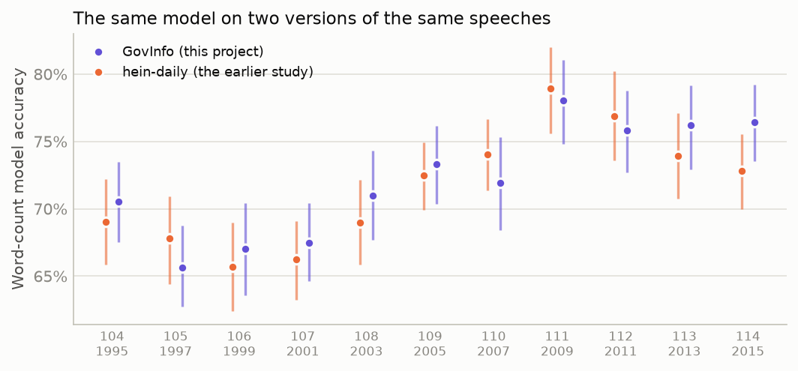
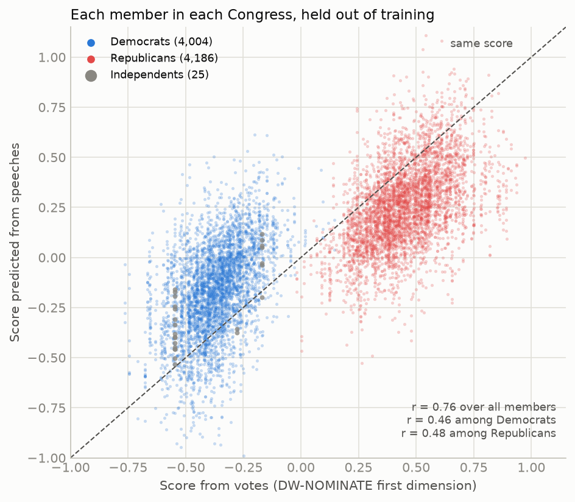

# Can a Language Model Hear Polarization?

*Testing how well one floor speech gives away a member of Congress's party, in each Congress from 1995 to 2026, and how well speeches predict the way members vote.*

<!-- Kevin: the next two paragraphs are the place for your own reason for asking. Replace or extend them. -->

On 3 November 2026, Democrats won control of both the House and the Senate ([Associated Press via PBS News, 4 November 2026](https://www.pbs.org/newshour/politics/democrats-win-control-of-the-u-s-house)). After every election I hear that the two parties now use very different language. I wanted to see whether the difference in how they speak can be measured, and whether it has kept growing in the last ten years.

There is a well-known way to measure it. Economists Matthew Gentzkow, Jesse Shapiro, and Matt Taddy asked how easily someone could guess a member's party from their speech in Congress, and found that it became much easier starting in the mid-1990s ([Gentzkow et al 2019](#references)). Their data end in 2016. I repeated the measurement with a modern language model on every Congress from 1995 to 2026, and also asked how well a member's speeches predict how they vote.

## What I found

1. **A single speech gives away the speaker's party more often than it did in the 1990s.** The language model guessed the party correctly for about 70% of test speeches in the 104th–106th Congresses (1995–2000) and about 82% in the 117th–119th (2021–2026). Congress by Congress, its accuracy rose and fell with the distance between the parties in roll-call votes (rank correlation 0.86).
2. **Since 2017, I could not tell whether it is still rising.** The trend over the five Congresses since 2017 was +0.2 percentage points per Congress, with a 95% range from −0.7 to +1.1. Over 1995–2016 the same measure was +1.0 points per Congress (0.7 to 1.3).
3. **The language model was only slightly better than counting words.** A simple model that counts words and two-word phrases was on average 1.3 percentage points less accurate (95% range 0.7 to 1.9), and it was more accurate in 3 of the 16 Congresses. Both models show the same rise.
4. **The change of data source does not explain the rise.** For 1995–2016 I ran the word-count model on my own copy of the speeches and on the copy used in the earlier study. The two gave matching accuracies in 10 of 11 Congresses.
5. **Speeches predict how members vote across the two parties, but much less within each party.** A model given only a member's speeches predicted their voting score with a correlation of 0.76 over all members, below the 0.85 I had predicted. Within each party the correlation was 0.46 for Democrats and 0.48 for Republicans.

In practice, floor speech separates the two parties much better than it did thirty years ago, and the rise between 1995 and 2016 has not reversed. Five Congresses are too few to say whether it is still rising. And speech says much more about which party a member belongs to than about their position within it.

## 1. The question and the earlier work

The Congressional Record prints what members say on the floor of the House and Senate each day. [Gentzkow et al (2019)](#references) used it to measure how *partisan* speech is: how well an observer who hears a short piece of speech can guess the speaker's party. By their estimate, the chance of guessing right from a one-minute speech changed little between 1873 (54%) and 1990 (57%), then rose to 73% by 2007–2009, with the rise beginning around the 1994 election. A similar idea was used for the British House of Commons by [Peterson & Spirling (2018)](#references), who treated the accuracy of a party classifier as a measure of polarization in its own right.

The usual measure of polarization in Congress comes from votes, not words. *DW-NOMINATE* places each member on a map built from roll-call votes, on which two members are close if their voting records are similar ([Voteview 2026a](#references)). Its first dimension runs from −1 to +1 and is often interpreted as economic liberalism versus conservatism ([Voteview 2026b](#references)). In the Voteview member file, the distance between the two parties' average scores on that dimension grew over the same period (Figure 1, bottom).

I asked three things:

- **Did the accuracy keep rising after 2016,** the last year of the earlier study?
- **Does a modern language model hear more than counting words does?**
- **Do speeches predict votes,** across all members and within each party? Earlier work has classified senators by ideology from their speeches ([Diermeier et al 2012](#references)) and estimated senators' positions from speech, finding a moderate within-party correlation with positions estimated from roll-call votes ([Lauderdale & Herzog 2016](#references)).

## 2. How I measured it

I downloaded the daily Congressional Record from the government's GovInfo site for every day from January 1995 to the end of September 2026, and split it into *turns*: one member speaking without interruption. Each turn is matched to its speaker by the identifier the Record's own metadata gives, and each speaker to their party and voting score in the Voteview member file ([Lewis et al 2026](#references)). That gave 821,359 turns of at least 50 words from Democrats and Republicans.

For each Congress I then trained a model to guess the party of a turn, and tested it on turns it had not seen. Several choices were needed to make the Congresses comparable:

- **The same number of turns in every Congress.** Each Congress gets 6,000 training turns and 1,000 test turns per party, three-quarters from the House and one-quarter from the Senate. The Record has fewer long turns now than in the 1990s (89,019 included turns in the 104th Congress, 25,779 in the 119th so far), so without this the later models would be trained on less data and the comparison would not be fair.
- **No speaker in both training and test.** Otherwise a model could learn a member's personal habits and recognise them in the test, which is not the same as recognising their party.
- **At most 100 turns from any one speaker in a split,** so that a few very active members do not dominate.
- **Repeated text removed.** A turn is dropped if its first 40 words appear in at least three turns in the same Congress, which removes read-in notices and lists of absent members.
- **Two models.** The main model is ModernBERT, a recent encoder-only language model ([Warner et al 2025](#references)) fine-tuned separately for each Congress with one fixed set of settings. The comparison model counts words and two-word phrases and fits a logistic regression, which is close in spirit to the earlier study's method.

Accuracy here means the share of the 2,000 test turns assigned the right party. Since the parties are balanced, guessing gives 50%. The 95% ranges come from resampling the test speakers, not the turns, because turns by the same member are not independent.

## 3. What I decided in advance

With sixteen Congresses and many ways to divide them, it is easy to find a pattern after looking at the data. So I wrote down the questions, the tests, and what would count as a yes before training any model, and committed them to the project's repository on 5 November 2026 ([the plan](https://github.com/kvenanzi/congress-speech/blob/main/docs/preregistration.md)). Writing the tests down first is what lets a reader tell a prediction from an explanation found afterwards ([Nosek et al 2018](#references)).

| Question | What would count as yes | Result |
|---|---|---|
| 1. Does the language model's accuracy rise and fall with the gap between the parties' votes? | Rank correlation above 0.7 across the 16 Congresses | **Yes.** 0.86 (95% range 0.61 to 0.98). |
| 2. Did accuracy rise, fall, or neither over 2017–2026? | Rising if the 95% range of the trend is above zero, falling if below | **Could not tell.** +0.2 points per Congress (−0.7 to +1.1). |
| 3. Is the language model more accurate than counting words? | Higher in all 16 Congresses, and the average difference clearly above zero | **Not quite.** Higher in 13 of 16; average difference 1.3 points (0.7 to 1.9). |
| 4. Does switching from the earlier study's copy of the Record to GovInfo change the results? | Matching accuracies in at least 9 of 11 Congresses, and rank correlation above 0.8 | **No change.** 10 of 11; rank correlation 0.85. |
| 5a. Do speeches predict the voting score over all members? | Correlation above 0.85 | **No.** 0.76 (0.75 to 0.78). |
| 5b. Is the prediction weak within each party? | Correlation below 0.5 for Democrats, and below 0.5 for Republicans | **Yes, for both.** 0.46 (0.41 to 0.50) and 0.48 (0.44 to 0.53). |

Four things were decided or found after the plan was written, and the plan's change log records each one with its reason. Non-voting delegates were excluded from every Congress, before any model was trained. Four settings tied in the search for the language model's settings, and the first was used. GovInfo files many Senate statements twice, which I found during the analysis, and removing the second copies changed no result. And all five folds of the voting-score model chose the smallest penalty the plan allowed, so I checked a wider range afterwards (section 8). Section D of the details lists these.

## 4. Thirty years of party in speech



*Figure 1. Top: the share of test speeches each model assigned to the right party, by Congress, with 95% ranges. Bottom: the Republican average minus the Democratic average of the DW-NOMINATE first dimension, over members who spoke. The shaded Congresses come after the end of the earlier study's data.*

Both models found it easier to tell the parties apart in later Congresses. The language model's accuracy was lowest in the 105th Congress (1997–1998), at 66.9%, and highest in the 119th (2025–2026), at 84.6%. The largest single step was into the 111th Congress (2009–2010). The 118th Congress (2023–2024) is lower than its neighbours for both models, at about 78%.

The bottom panel shows the gap between the parties in roll-call votes. It grew in every Congress but two, and the accuracy follows it: the rank correlation between the two series is 0.86 for the language model and 0.94 for the word-count model. The range for the language model is wide (0.61 to 0.98) because there are only 16 Congresses.

## 5. Since 2017

The main question was whether accuracy kept rising after the earlier study's data end. Over the five Congresses from 2017 to 2026, the language model's accuracy went 80.9%, 83.3%, 82.3%, 78.2%, and 84.6%. A straight line through them rises by 0.2 percentage points per Congress, and the 95% range runs from −0.7 to +1.1. So the data allow a small decline, no change, or a rise similar to the earlier period. Over 1995–2016 the same line rose by 1.0 point per Congress (0.7 to 1.3), and the word-count model gives the same picture in both periods.

What the data do show is that accuracy has not gone back down. Every Congress since 2017 is above every Congress before 2009.

## 6. The language model against counting words

I expected a modern language model to be clearly better at this than counting words, because it can use word order and context. It was better, but by much less than I expected: 1.3 percentage points on average, more accurate in 13 of 16 Congresses, and less accurate in the 109th, 112th, and 118th. The plan required it to be better in all 16, so the answer to question 3 is not quite. Most of what separates the parties' speeches can be found from which words they use.

One possible explanation is that the models learn the parties' names: a speech that says "my Republican colleagues" probably comes from a Democrat. To check, I replaced Democrat, Democrats, Democratic, Republican, Republicans, and GOP with a placeholder in the test speeches. The language model's accuracy fell by 0.4 points on average and by at most 1.25 points (114th Congress), so the parties' names explain very little.

## 7. Does the change of source matter?

The earlier study used a copy of the Record that ends in 2016, and I used GovInfo for every year. If GovInfo's text was split into turns differently, the rise could partly reflect the change of source. So for the eleven Congresses that both copies cover, I trained and tested the word-count model on each copy with the same rules.



*Figure 2. Accuracy of the word-count model on the earlier study's copy of the Record (hein-daily) and on GovInfo, for the Congresses both cover, with 95% ranges.*

The two copies gave accuracies within each other's 95% ranges in 10 of the 11 Congresses, and the two series have a rank correlation of 0.85. The exception is the 114th Congress (2015–2016), where GovInfo gave 76.5% and the earlier copy 72.8%. The average difference over all eleven was 1.7 points. The change of source does not explain the rise.

## 8. Speeches and votes

The last question was how well a member's speeches predict their DW-NOMINATE score. For each member in each Congress with at least 10 turns, I turned every turn into a list of numbers that describes its meaning, using a sentence-embedding model ([Xiao et al 2024](#references)), and averaged them. A ridge regression ([Hoerl & Kennard 1970](#references)) then predicted the voting score from that average. Every member was predicted by a model that had never seen any of their speeches, in any Congress. This covers 8,215 member-Congresses from 1,648 members.



*Figure 3. Each point is one member in one Congress: the horizontal position is the score from votes and the vertical position is the score predicted from speeches. Points on the dashed line were predicted exactly.*

<!-- qmd
::: {.column-page-right}
```{=html}
<iframe src="figures/nominate.html" title="Predicted against actual voting scores, with member names"
        loading="lazy" style="border:none;width:100%;height:580px"></iframe>
```
:::
-->

The interactive chart [`figures/nominate.html`](figures/nominate.html) shows the same points with each member's name, state, Congress, and number of speeches when you hover over a point.

Over all members, the correlation between predicted and actual scores is 0.76 (95% range 0.75 to 0.78). That is strong, but below the 0.85 I predicted. Most of it comes from the gap between the parties: the predictions form two clouds, one for each party. Within each party the correlation is much lower, 0.46 for Democrats (0.41 to 0.50) and 0.48 for Republicans (0.44 to 0.53), and I could not tell the two apart. [Lauderdale & Herzog (2016)](#references) reported a within-party correlation of 0.46 between speech-based and vote-based positions for senators from 1995 to 2014. That is a single figure for both parties, from a different method and their own vote-based scale, so it is not directly comparable, but it is of a similar size. The predictions are also pulled toward the middle: members near either end of the voting scale are predicted to be more moderate than they vote.

So a member's speeches carry much more information about which party they are in than about whether they vote with the centre or the edge of that party. The plan asked for the ten largest differences in each party to be listed by name, and they are in section C of the details, without comment. A large difference means only that a member's speeches resemble those of members who vote differently from them. It does not show why.

**A check I added afterwards.** Every fold of the regression chose the smallest penalty the plan allowed, which can mean that a smaller one would fit better. I repeated the analysis with a wider range. The best fold-by-fold choice raised the overall correlation from 0.76 to 0.78, and both within-party correlations stayed below 0.5 at every penalty tried. No answer changes.

## 9. What could be wrong

- **Five Congresses is a short series.** "Could not tell" in section 5 means the data allow a rise, a fall, or no change. It is not evidence that the trend has stopped.
- **The 119th Congress is not finished.** Its turns run to 30 September 2026, and the Congress continues until January 2027, including a session after the election. Speech from the rest of the term could move its accuracy.
- **Fewer speakers supply the test speeches.** The share of test turns from the ten most active test speakers rose from 17% in the 104th Congress to 24% in the 119th, which I take to mean that fewer members now give long floor speeches. With fewer distinct voices, a test is more affected by individual habits, which could raise or lower accuracy. The 100-turn cap limits this but does not remove it.
- **Accuracy measures how different the speech is, not why.** It rises if the parties talk about different topics, use different words for the same topic, or simply give more scripted speeches. These data cannot separate those.
- **The floor is not all of politics.** Floor speeches are a small part of what members say. Committee hearings, interviews, and social media may show a different pattern.
- **Repeated Senate statements.** GovInfo prints many Senate bill-introduction statements twice. At most 5 of the 2,000 test turns of any Congress are affected, and removing the second copies changed no accuracy by more than 0.1 point.

## 10. What I take from this

One floor speech gives away the speaker's party much more often than it did in the 1990s, about 82% of the time in the last three Congresses against about 70% in the first three. That rise followed the growing gap between the parties' votes, it appears in a simple word count as well as in a modern language model, and it does not come from the change of data source. Since 2017 the accuracy has stayed at its new level, and five Congresses are too few to say whether it is still rising.

The speech-and-votes result was the one I found most useful. Averaged over a Congress, a member's floor speeches predicted which party's side of the scale they vote on much better than their place within their own party. In that sense, the speeches sound more like the party than like the member's own voting record.

The next Congress begins in January 2027. Adding it in two years will make the post-2016 trend a six-point series rather than five.

---

## Details for anyone who wants to check the work

### A. Data

- **Speeches:** the daily Congressional Record (House and Senate sections) from [GovInfo](https://www.govinfo.gov/app/collection/crec), every issue from January 1995 to 2 November 2026, fetched on 5 November 2026. The Extensions of Remarks and the Daily Digest are excluded because they are not spoken on the floor. The last turn in the corpus is from 30 September 2026. The Record is a work of the US government and in the public domain.
- **Turns:** 1,605,152 member turns, parsed by the turn openings ("Mr. SMITH.", "Ms. JONES of Texas.") and attributed by the bioguide identifier in each granule's MODS record. 3,838 turns could not be matched to a member and were dropped; 1,832 were matched by surname, state, chamber, and Congress when the MODS record was missing.
- **Inclusion:** 841,587 turns had at least 50 words. Of those, 7,092 were removed by the repeated-opening rule, 1,861 belonged to members who changed party within a Congress, 6,178 to non-voting delegates, and 3,214 to independents (who are kept for the voting-score regression). 821,359 turns were included for party classification.

  | Congress | 104 | 105 | 106 | 107 | 108 | 109 | 110 | 111 |
  |---|---|---|---|---|---|---|---|---|
  | Included turns | 89,019 | 67,834 | 69,714 | 59,332 | 65,091 | 61,670 | 67,325 | 61,748 |

  | Congress | 112 | 113 | 114 | 115 | 116 | 117 | 118 | 119 |
  |---|---|---|---|---|---|---|---|---|
  | Included turns | 47,195 | 41,043 | 39,065 | 37,361 | 31,538 | 28,483 | 29,162 | 25,779 |

- **Party and voting score:** Voteview `HSall_members.csv`, downloaded 5 November 2026 ([Lewis et al 2026](#references)), joined on bioguide identifier and Congress. Party code 100 is Democratic and 200 Republican.
- **Comparison copy:** the hein-daily parse of the Record by Gentzkow, Shapiro, and Taddy, distributed by Stanford Libraries ([Gentzkow et al 2018](#references)). It covers the 97th–114th Congresses; I used the 104th–114th, and only for question 4.
- **Samples:** speakers in each Congress were split 65/15/20 into training, validation, and test, stratified by party and chamber, seed 20261105. The plan asked for 7,000 training and 2,000 test turns per party; its fallback rule reduced every Congress to 6,000 training, 1,000 validation, and 1,000 test turns per party, because the later Congresses could not supply more after the 100-turn cap.

### B. Models

- **Word-count model:** TF-IDF on word unigrams and bigrams (minimum document frequency 5, sublinear term frequency), L2 logistic regression, regularisation strength chosen per Congress on validation accuracy over {0.1, 0.3, 1, 3, 10}.
- **Language model:** `answerdotai/ModernBERT-base` ([Warner et al 2025](#references)) fine-tuned for two-class classification. The settings came from a 15-trial search with Optuna's TPE sampler ([Akiba et al 2019](#references)) on the 108th Congress, maximising validation accuracy, and were then used unchanged for every Congress: learning rate 3.7 × 10⁻⁵, 2 epochs, warmup 9.8% of steps, 512 tokens, batch size 16, weight decay 0.047, seed 20261105. Validation accuracy across the trials ranged from 68.3% to 74.65%.

<!-- qmd
::: {.column-page-right}
```{=html}
<iframe src="figures/sweep.html" title="The 15 settings tried for ModernBERT, parallel coordinates"
        loading="lazy" style="border:none;width:100%;height:460px"></iframe>
```
:::
-->

The interactive chart [`figures/sweep.html`](figures/sweep.html) draws each of the 15 settings as a line from its six values to its validation accuracy. Dragging along an axis highlights the settings in that range.

- **Seed variation:** the 115th and 119th Congresses were also trained with seeds 1 and 2. Test accuracy across the three seeds was 80.25–81.55% (115th) and 84.55–84.65% (119th); the reported accuracy for these two Congresses is the mean of the three.
- **Intervals:** 2,000 cluster-bootstrap resamples of test speakers (all of a speaker's test turns together), seed 20261105. The trend in question 2 is an ordinary least-squares slope of accuracy on Congress number, with the five Congresses' speakers resampled jointly. The rank correlation in question 1 is Spearman's, with its range from resampling Congresses.
- **Voting-score model:** each turn of 50 or more words by a member in the Voteview file (independents included, delegates and party switchers excluded, repeated openings removed) was embedded with `BAAI/bge-base-en-v1.5` ([Xiao et al 2024](#references)), truncated at 512 tokens and normalised, and the embeddings were averaged per member and Congress. Members with fewer than 10 such turns in a Congress were dropped, leaving 821,674 turns. Ridge regression on the DW-NOMINATE first dimension, penalty chosen by an inner 3-fold grouped cross-validation over {0.1, 1, 10, 100}, inside an outer 5-fold cross-validation grouped by member across all Congresses. Correlation intervals come from 2,000 resamples of members.

### C. Full results

| Congress | Years | Language model | 95% range | Word counts | 95% range | Party vote gap |
|---|---|---|---|---|---|---|
| 104 | 1995–96 | 73.4% | 70.1–76.5 | 70.6% | 67.3–73.4 | 0.745 |
| 105 | 1997–98 | 66.9% | 63.9–69.6 | 65.7% | 62.6–68.6 | 0.761 |
| 106 | 1999–00 | 69.3% | 66.1–72.4 | 67.1% | 63.4–70.5 | 0.759 |
| 107 | 2001–02 | 68.2% | 64.8–71.4 | 67.5% | 64.5–70.4 | 0.764 |
| 108 | 2003–04 | 71.7% | 67.9–75.0 | 71.0% | 67.6–74.3 | 0.768 |
| 109 | 2005–06 | 73.1% | 70.3–76.0 | 73.3% | 70.4–76.2 | 0.787 |
| 110 | 2007–08 | 72.2% | 68.8–75.1 | 71.9% | 68.2–75.3 | 0.785 |
| 111 | 2009–10 | 81.0% | 78.0–83.8 | 78.1% | 74.7–81.1 | 0.788 |
| 112 | 2011–12 | 75.5% | 72.1–78.7 | 75.8% | 72.6–78.9 | 0.837 |
| 113 | 2013–14 | 77.6% | 73.9–80.6 | 76.2% | 72.8–79.2 | 0.852 |
| 114 | 2015–16 | 77.8% | 74.7–80.7 | 76.5% | 73.5–79.1 | 0.862 |
| 115 | 2017–18 | 80.9% | 78.4–83.3 | 78.7% | 75.5–82.0 | 0.865 |
| 116 | 2019–20 | 83.3% | 80.7–85.7 | 80.2% | 77.2–82.6 | 0.870 |
| 117 | 2021–22 | 82.3% | 79.3–85.1 | 82.1% | 79.0–84.8 | 0.879 |
| 118 | 2023–24 | 78.2% | 73.4–82.3 | 78.3% | 73.5–82.6 | 0.896 |
| 119 | 2025–26 | 84.6% | 81.9–87.5 | 81.8% | 78.1–85.5 | 0.915 |

- **Question 1:** Spearman ρ between language-model accuracy and the party vote gap 0.859 (95% range 0.613 to 0.982). Word-count model: 0.938 (0.795 to 0.991).
- **Question 2:** language model, slope over the 115th–119th Congresses +0.0022 per Congress (−0.0068 to +0.0113), not distinguishable; over the 104th–114th, +0.0100 (+0.0069 to +0.0128). Word-count model: +0.0043 (−0.0070 to +0.0153) and +0.0109 (+0.0081 to +0.0137).
- **Question 3:** mean paired difference, language model minus word counts, +0.0134 (+0.0070 to +0.0191). The word-count model was more accurate in the 109th (by 0.25 points), 112th (0.30), and 118th (0.10).
- **Question 4:** 10 of 11 Congresses within each other's ranges; Spearman ρ 0.855; mean absolute difference 1.74 points. The exception is the 114th: GovInfo 76.45% (73.5–79.2), hein-daily 72.8% (70.0–75.5).
- **Question 5:** held-out Pearson r over all 8,215 member-Congresses 0.763 (0.748 to 0.776); Democrats (4,004) 0.455 (0.406 to 0.502); Republicans (4,186) 0.485 (0.441 to 0.528). The 25 independent member-Congresses are in the overall figure only. The upper ends of both within-party ranges are just above 0.5.
- **Wider penalty check (exploratory):** with the grid widened to {0.0001, 0.001, 0.01, 0.03, 0.1, 1, 10, 100}, every outer fold chose 0.01, giving r = 0.783 (0.770 to 0.795) over all members, 0.440 for Democrats, and 0.488 for Republicans. Across fixed penalties the highest overall r was 0.785 (penalty 0.001), and within-party r stayed below 0.5 at every value.

The planned sensitivity analyses, which were reported but not used for any verdict:

- **Party names masked:** mean drop in language-model accuracy 0.45 points, largest 1.25 points (114th).
- **By chamber:** average accuracy over the 16 Congresses was 76.7% in the House and 73.7% in the Senate for the language model, 75.1% and 73.4% for word counts. The Senate supplies a quarter of the test turns from about 20 test speakers, so its ranges are wide.
- **By length:** average language-model accuracy was 74.1% for the shortest third of test turns, 76.3% for the middle third, and 77.6% for the longest.
- **By party:** the language model's average recall was 75.1% for Democratic turns and 75.4% for Republican turns. In 24 of 31 chamber-Congresses, the majority party's turns were recognised more often than the minority's, by 4.2 points on average.
- **Repeated texts removed:** no verdict changed, and no Congress's accuracy moved by more than 0.10 points.

**The ten largest differences in each party** between the score predicted from speeches and the score from votes. Listed as the plan requires, with no characterisation. "Votes" is the DW-NOMINATE first dimension.

| Democrats | State | Congress | Chamber | Votes | Speeches | Turns |
|---|---|---|---|---|---|---|
| Robert A. Brady | PA | 110 | House | −0.484 | +0.464 | 43 |
| Martin Olav Sabo | MN | 107 | House | −0.516 | +0.415 | 19 |
| Marc Veasey | TX | 118 | House | −0.409 | +0.474 | 28 |
| Robert A. Brady | PA | 115 | House | −0.484 | +0.399 | 21 |
| John Yarmuth | KY | 116 | House | −0.378 | +0.503 | 15 |
| Yvette Diane Clarke | NY | 117 | House | −0.607 | +0.267 | 28 |
| Jamie Ben Raskin | MD | 118 | House | −0.494 | +0.360 | 204 |
| Peter Visclosky | IN | 114 | House | −0.402 | +0.449 | 68 |
| Raúl M. Grijalva | AZ | 110 | House | −0.598 | +0.234 | 152 |
| Michael Avery Ross | AR | 110 | House | −0.201 | +0.612 | 154 |

| Republicans | State | Congress | Chamber | Votes | Speeches | Turns |
|---|---|---|---|---|---|---|
| Gary G. Miller | CA | 108 | House | +0.478 | −0.414 | 18 |
| Edward Randall Royce | CA | 115 | House | +0.657 | −0.227 | 232 |
| Edward Randall Royce | CA | 108 | House | +0.657 | −0.208 | 63 |
| Gary G. Miller | CA | 112 | House | +0.478 | −0.365 | 40 |
| Trent Kelly | MS | 118 | House | +0.636 | −0.183 | 10 |
| Joshua David Hawley | MO | 116 | Senate | +0.820 | +0.010 | 43 |
| Bill Posey | FL | 116 | House | +0.533 | −0.274 | 16 |
| Joshua David Hawley | MO | 118 | Senate | +0.820 | +0.014 | 42 |
| Greg Lopez | CO | 118 | House | +0.894 | +0.093 | 17 |
| Elise M. Stefanik | NY | 116 | House | +0.309 | −0.491 | 29 |

Names are as Voteview gives them. Many of these members have few turns in that Congress, and an average of 10 to 20 speeches is a noisy description of a member.

**Every run finished.** All 15 search trials, 20 language-model runs (16 Congresses plus two extra seeds for two of them), 27 word-count runs (16 on GovInfo, 11 on hein-daily), and the embedding run completed without a failure. The voting-score regression was run twice with identical results; the second run added member names to the output.

### D. Decisions

| Decision | Reason |
|---|---|
| GovInfo for every year, hein-daily only as a check | One source and one parser for the whole period |
| Party and voting score from Voteview for every Congress | Avoids differences between the Record's metadata and Voteview's |
| Fixed turns per party, chamber mix, and 100-turn cap per speaker | Corpus size, party balance, and a few active members cannot create a trend |
| Speakers split between training and test | A model must recognise the party, not the person |
| Non-voting delegates excluded everywhere (added before training) | Voteview lists them in some Congresses and not others |
| One set of language-model settings, chosen on the 108th Congress | Tuning each Congress separately could create differences between Congresses |
| First of four tied search trials used (recorded before any test accuracy) | The plan did not say how to break a tie; it is what Optuna returns |
| Repeated Senate statements kept, with a check without them | Found after the results; the samples were built by the plan's rules |
| Wider penalty range reported as exploratory only | Found after the result; the plan fixed the range |
| Confidence ranges from resampling speakers | Turns by the same member are not independent |

### E. Reproduction

- **Code and plan:** [github.com/kvenanzi/congress-speech](https://github.com/kvenanzi/congress-speech). Scripts `01`–`06` fetch, parse, join, sample, fit the word-count model, and publish the data; the three notebooks run the language model and the embeddings on Colab; `07`–`10` run the voting-score regression and the tests; `tools/post_analysis.py` makes the figures and [`figures/data.json`](figures/data.json).
- **Dataset:** [kvenanzi/congressional-record-speeches-1995-2026](https://huggingface.co/datasets/kvenanzi/congressional-record-speeches-1995-2026) (every turn with its speaker, party, voting score, and flags; the fixed samples; the embeddings).
- **Model:** [kvenanzi/congress-party-classifier](https://huggingface.co/kvenanzi/congress-party-classifier), the 119th-Congress language model.
- **Runs:** [`figures/runs.json`](figures/runs.json) lists the 70 runs of MLflow experiment `congress-speech`, exported on 6 November 2026, with their settings, results, and tags.
- **Compute:** Colab L4 GPU: 6.8 hours and about 20 compute units (2.5 hours and 4.9 units for the search, 3.6 hours and 14.0 units for the 20 language-model runs, 0.7 hours and 1.3 units for the embeddings). The unit figures are estimates from the hours and the rate Colab showed at the start of each session. Everything else ran on a laptop CPU.

## How this was made

I chose the question, approved the plan, ran the GPU notebooks, and edited the text. Claude Code wrote the code, ran the analysis, found the references, and drafted the post.

Claude checked each citation against its source: against the full text where an open copy existed, and against the abstract for Diermeier et al 2012.

## References

**Speech and polarization in Congress**

- Diermeier D, Godbout J-F, Yu B, Kaufmann S (2012). "Language and ideology in Congress". *British Journal of Political Science* 42(1):31–55. [doi:10.1017/S0007123411000160](https://doi.org/10.1017/S0007123411000160)
- Gentzkow M, Shapiro JM, Taddy M (2018). "Congressional Record for the 43rd–114th Congresses: Parsed Speeches and Phrase Counts". Stanford Libraries, distributed 16 January 2018, ODC-By licence. [data.stanford.edu/congress_text](https://data.stanford.edu/congress_text)
- Gentzkow M, Shapiro JM, Taddy M (2019). "Measuring group differences in high-dimensional choices: method and application to congressional speech". *Econometrica* 87(4):1307–1340. [doi:10.3982/ECTA16566](https://doi.org/10.3982/ECTA16566)
- Lauderdale BE, Herzog A (2016). "Measuring political positions from legislative speech". *Political Analysis* 24(3):374–394. [doi:10.1093/pan/mpw017](https://doi.org/10.1093/pan/mpw017)
- Lewis JB, Poole K, Rosenthal H, Boche A, Rudkin A, Sonnet L (2026). "Voteview: Congressional Roll-Call Votes Database". Member file downloaded 5 November 2026. [voteview.com](https://voteview.com/)
- Peterson A, Spirling A (2018). "Classification accuracy as a substantive quantity of interest: measuring polarization in Westminster systems". *Political Analysis* 26(1):120–128. [doi:10.1017/pan.2017.39](https://doi.org/10.1017/pan.2017.39)
- Voteview (2026a). "About the project". Accessed 6 November 2026. [voteview.com/about](https://voteview.com/about)
- Voteview (2026b). "Data - Member Ideology", last updated 22 January 2026. [voteview.com/articles/data_help_members](https://voteview.com/articles/data_help_members)

**Methods and software**

- Akiba T, Sano S, Yanase T, Ohta T, Koyama M (2019). "Optuna: a next-generation hyperparameter optimization framework". *Proceedings of the 25th ACM SIGKDD International Conference on Knowledge Discovery & Data Mining*:2623–2631. [doi:10.1145/3292500.3330701](https://doi.org/10.1145/3292500.3330701)
- Hoerl AE, Kennard RW (1970). "Ridge regression: biased estimation for nonorthogonal problems". *Technometrics* 12(1):55–67. [doi:10.1080/00401706.1970.10488634](https://doi.org/10.1080/00401706.1970.10488634)
- Nosek BA, Ebersole CR, DeHaven AC, Mellor DT (2018). "The preregistration revolution". *Proceedings of the National Academy of Sciences* 115(11):2600–2606. [doi:10.1073/pnas.1708274114](https://doi.org/10.1073/pnas.1708274114)
- Warner B, Chaffin A, Clavié B, Weller O, Hallström O, Taghadouini S, Gallagher A, Biswas R, Ladhak F, Aarsen T, Cooper N, Adams G, Howard J, Poli I (2025). "Smarter, better, faster, longer: a modern bidirectional encoder for fast, memory efficient, and long context finetuning and inference". *Proceedings of the 63rd Annual Meeting of the Association for Computational Linguistics*:2526–2547. [doi:10.18653/v1/2025.acl-long.127](https://doi.org/10.18653/v1/2025.acl-long.127)
- Xiao S, Liu Z, Zhang P, Muennighoff N, Lian D, Nie J-Y (2024). "C-Pack: packed resources for general Chinese embeddings". *Proceedings of the 47th International ACM SIGIR Conference on Research and Development in Information Retrieval*:641–649. [doi:10.1145/3626772.3657878](https://doi.org/10.1145/3626772.3657878)
